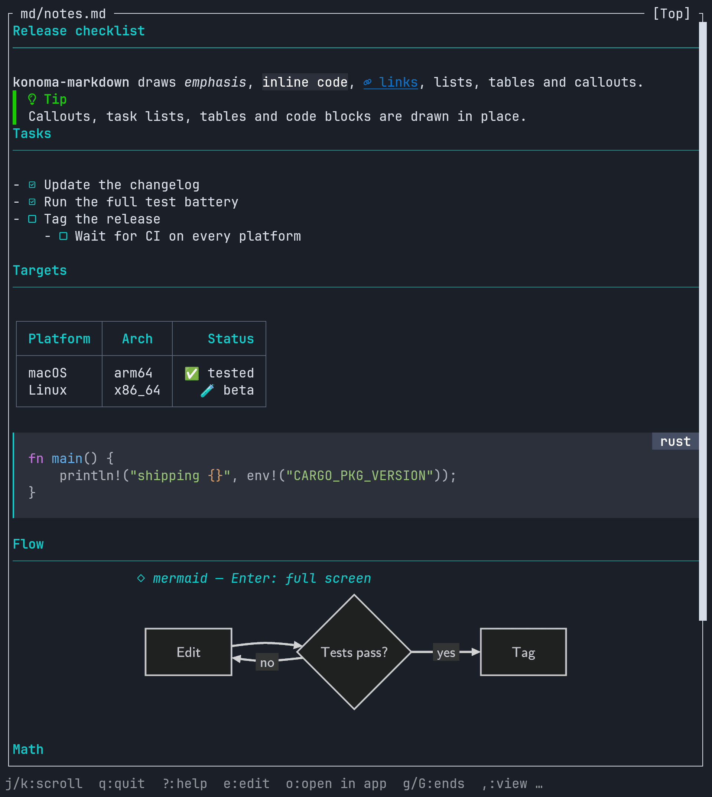

# konoma-markdown

Markdown for [konoma](https://github.com/LESIM-Co-Ltd/konoma), a terminal file browser: the
`markdown` plugin and the parsing library behind it.



| Crate | What it is |
|---|---|
| [`konoma-markdown`](crates/konoma-markdown/README.md) | The `markdown` plugin, and a standalone program that opens one `.md` file |
| [`konoma-markdown-core`](crates/konoma-markdown-core/README.md) | Block model, block-level diff and source analysis; draws nothing |

konoma already includes the plugin, so konoma users have nothing to install from here. The
standalone program is a plain reader: link focus, search, folding and checkbox toggling are
[konoma features](crates/konoma-markdown/README.md#standalone-program) it does not have.

## Try it

From a clone of this repository:

```sh
cargo run -- samples/markdown.md
```

Press `?` for the keys and `q` to quit.

The files in `samples/`, `markdown.md` included, are copied from konoma, so read them with that in
mind:

- Their text describes konoma. Where `markdown.md` says to use `Tab` then `Enter` (links,
  checkboxes, `<details>`), the standalone program does not do it.
- The local pictures that `markdown.md` and `images.md` refer to are not in this repository.

## Build and test

Rust 1.92 or newer. CI runs on macOS and Linux, with and without default features.

```sh
cargo build
cargo nextest run
cargo test --doc
cargo nextest run --no-default-features
```

On Ubuntu, CI first installs `pkg-config cmake libssl-dev zlib1g-dev`.

## License

[MIT](LICENSE)
