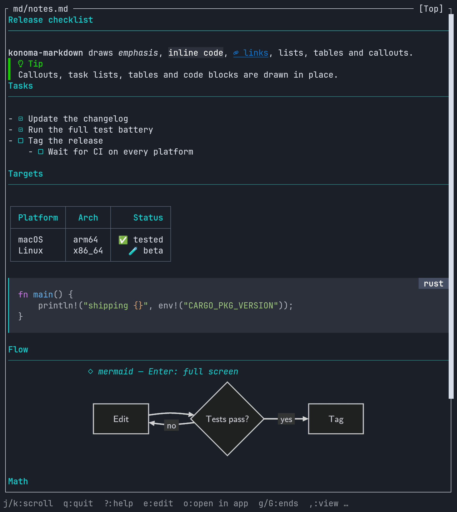

# konoma-markdown

The `markdown` plugin of [konoma](https://github.com/LESIM-Co-Ltd/konoma): Markdown files shown as
formatted documents.



## Files

`*.md`, ignoring case (`.markdown` and `.mmd` files are not taken). Inside konoma the plugin also
shows documents that other plugins convert to Markdown, such as Word files.

## With konoma

konoma has this plugin built in; there is nothing to install. `konoma --plugins` lists it.

- `konoma plugin install konoma-markdown` is refused: the crate is already part of konoma.
- Pointing konoma at the standalone program (`--plugin`) does not replace the built-in plugin:
  konoma does not load a second plugin with the id `markdown`.

The plugin only says which files are Markdown, reads them and passes on the settings. konoma does
the drawing and everything that works on the document: focusing links, checkboxes and code blocks,
outline, folding, search, the rendered diff, the source view and toggling checkboxes.

## Standalone program

```sh
cargo install konoma-markdown
```

It is a reader: it draws the document and scrolls it. It has **none** of the document operations
listed above, so links cannot be followed, a closed `<details>` cannot be opened and checkboxes
cannot be toggled. `Tab` and `Enter` do nothing in this program, even though a diagram is labelled
`Enter: full screen`; those operations work in konoma itself.

```text
konoma-markdown <file.md>    show a file in the terminal
konoma-markdown --help, -h   print usage
konoma-markdown --version    print the plugin id and version
konoma-markdown --manifest   print the plugin's declarations as JSON
konoma-markdown --serve      speak the plugin protocol on stdin/stdout (for a host program)
```

`--plugin markdown` may be given as well. Directories and other files are refused. Showing a file
needs a terminal on standard input and output.

### What you see

Headings, lists, tables (including HTML `<table>`), highlighted code blocks, block quotes and
GitHub alerts, footnotes, emoji shortcodes, front matter and `<details>`. Local pictures, mermaid
diagrams and LaTeX math are drawn as pictures. If the terminal supports a graphics protocol (kitty
graphics, iTerm2 or sixel), also through tmux, they are real images. A protocol is not required:
when none can be detected, they appear as half-block approximations.

`http(s)://` pictures are downloaded by the program itself, with the Rust HTTP library `ureq`. Set
`[external] remote_images = false` to stop that.

### Keys

| Key | Action |
|---|---|
| `j` `k`, `↓` `↑` | Scroll |
| `g` `G` | Top / bottom |
| `Ctrl-f` `Ctrl-b`, `PageDown` `PageUp` | Page down / up |
| `Ctrl-d` `Ctrl-u` | Half page down / up |
| `h` `l`, `0` `$` | Scroll sideways, line start / end (when wrapping is off) |
| `,` then `w`, or `Space` `w` | Toggle wrapping |
| `,` then `p`, or `Space` `h` | Change how the path is written in the title |
| `y` then `n` `r` `f` `p` `@` | Copy to the clipboard: name, relative path, full path, parent, `@` reference |
| `e` | Open the file in your editor |
| `o`, or `Space` `o` | Open the file with the operating system's default application (off with `[external] open_links = false`) |
| `?`, or `Space` `?` | Help |
| `q`, `Esc`, `Q`, or `Space` `d` | Quit |

With `[ui] keys = "less"`, page and half-page movement are `f` `b` and `d` `u` without `Ctrl`.

### Configuration

The program reads konoma's config file, `$XDG_CONFIG_HOME/konoma/config.toml`, if there is one.

```toml
[ui]
lang = "en"            # "auto", "en" or "jp"
keys = "less"          # f b d u instead of Ctrl-f Ctrl-b Ctrl-d Ctrl-u
wrap = false

[editor]
command = "nvim"       # otherwise $VISUAL, then $EDITOR, then vim

[external]
remote_images = false  # default: true
open_links = false     # default: true; turns `o` off

[plugins.markdown]     # the values shown are the defaults
alerts = true
emoji = true
frontmatter = true
footnotes = true
autolink = true        # turn bare URLs into links
inline_html = true
details = "auto"       # "auto", "open" or "closed"
table_align = "left"   # "left", "center" or "right"
image_align = "center" # "left", "center" or "right"
```

`[plugins.markdown] task_states` is also declared; it matters only where checkboxes can be toggled,
that is, in konoma.

### Limits

- At most 1 MiB and 5,000 lines of a file are shown; a note marks the cut.
- Bytes that are not UTF-8 are replaced.

## As a library

`MarkdownPlugin`, `markdown_manifest()`, `MARKDOWN_ID` and `CONTENT_TYPE` describe the plugin;
`read_limited()` and `doc_options()` are how it reads a file and maps settings; `plugins()` returns
the `markdown` plugin only, not the mermaid and math renderers the program also carries. Parsing lives in
[`konoma-markdown-core`](https://github.com/LESIM-Co-Ltd/konoma-markdown/tree/main/crates/konoma-markdown-core).

The default feature `app` builds the standalone program, including the mermaid and math renderers.
Use `default-features = false` to depend on the plugin alone.

MIT licensed.
